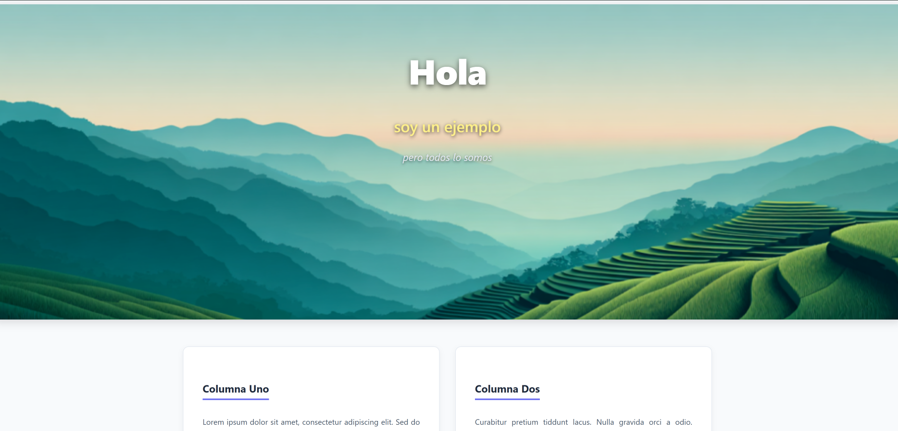
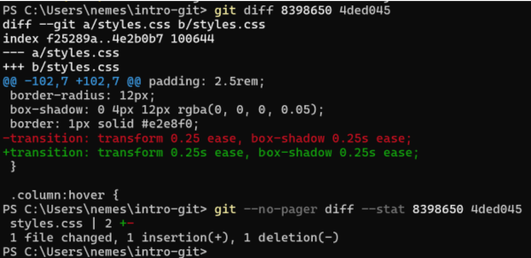

# intro-git

Práctica de introducción a Git: clonado, navegación por el historial, comparación de commits, ramas, fusiones, resolución de conflictos y publicación en un repositorio propio.

## Estado anterior de la web

## Cambios del commit 4ded045

## Historial de ramas

## Dos columnas editadas en main

## Resolución del conflicto

